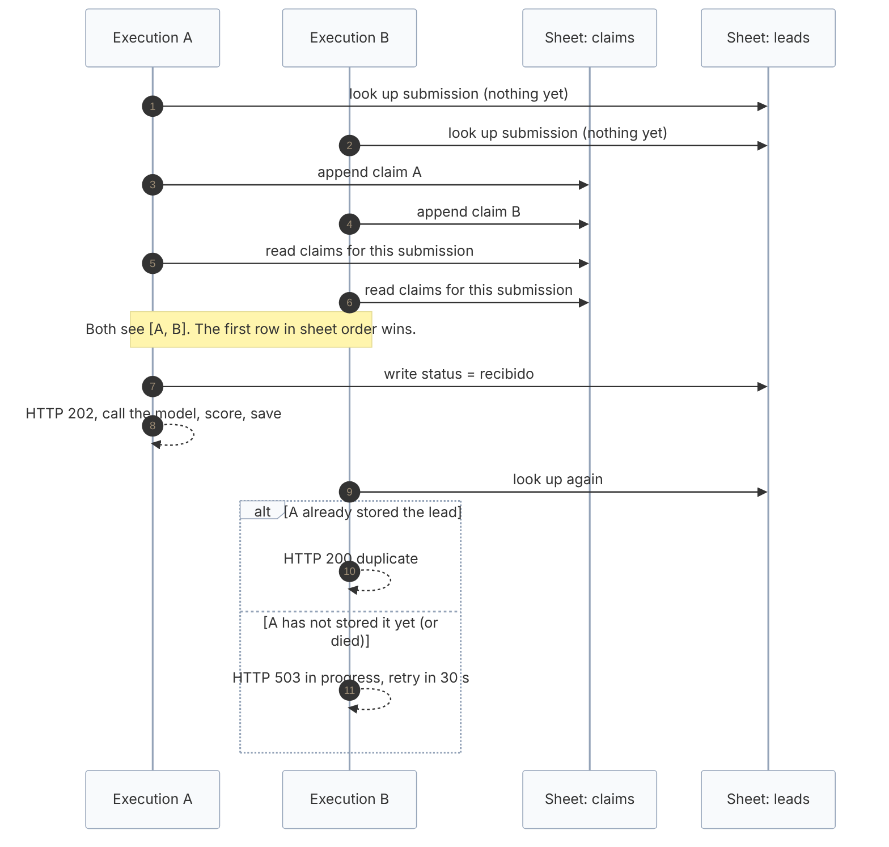

# Duplicates and concurrency

The goal: the same lead sent twice produces **one** lead row, **one** task and **one** model call, even when both requests arrive at the same moment.

**Status in one sentence:** sequential repeats are handled and tested; simultaneous repeats are handled by an arbitration protocol that is proven exhaustively in a simulator and held in one small live run on n8n Cloud and Google Sheets; a real guarantee needs a database with a unique constraint, which is provided as an option but not wired into the workflow.

## Layer 1: identity

Every lead gets stable ids derived on the server, never taken from the request:

- `lead_id = "L-" + sha256(email)[:12]`
- `submission_id = lead_id + "-" + sha256(email | normalised message | source)[:10]`

The same person with the same message and source always has the same `submission_id`. A new message from the same e-mail is a new submission, flagged `contacto_repetido`.

## Layer 2: history lookup (sequential repeats)

Before doing any work the workflow reads the `leads` rows for the `lead_id` and decides (`decideDuplicate`):

| Situation | Decision | HTTP |
| --- | --- | --- |
| No row for this submission | process | 202 |
| Row exists and is finished, in the retry queue, or needs manual review | ignore | 200 `{duplicate:true}` |
| Row is `recibido` for more than 15 minutes (a run died) | process again, retry counter + 1 | 202 |
| Row is `recibido` for less than 15 minutes | ignore (in progress) | 200 |
| Same `submission_id` but a different e-mail (hash collision) | conflict | 409 |
| Ten or more other submissions from the same contact | ignore | 429 |

This is enough for double clicks, client retries and replays. It is **not** enough for two requests that are processed at the same instant, because both can read an empty history.

## Layer 3: claim arbitration (simultaneous repeats)

Google Sheets has no unique constraint and no transactions. v1.1 adds a `claims` tab and an insert-then-verify protocol that uses only operations the sheet offers:

1. The execution **appends** a claim row `{claim_key, submission_id, claim_id, claimed_at}`. `claim_key = submission_id#retry_count`; `claim_id` is unique per execution.
2. It **reads** all claims.
3. Among the rows with the same `claim_key` whose `claimed_at` is within 30 seconds of its own, the **first in sheet order** wins. Every executor sees the same order, so they agree.
4. The winner writes the `recibido` row, answers 202 and continues. Losers stop.
5. A loser looks the lead up again: if the winner already stored it, it answers `200 duplicate`; if not, it answers `503 in_progress` with `retry_after_seconds: 30`.
6. If its own claim is not visible in the read (the sheet is behind), the execution treats that as an error and does **not** proceed; it answers 503 as well.

A claim older than the window is ignored, so a winner that crashed cannot block the next retry for ever.



Editable source: [`diagrams/concurrency-sequence.mmd`](diagrams/concurrency-sequence.mmd).

## What was tested

`tests/concurrency.test.js` runs the real generated Code nodes in a simulator where each execution is a generator that yields before every external operation, so a test can choose the exact interleaving:

- two identical requests in **every** interleaving of their first 10 steps produce one lead, one task and one model call;
- a **negative control**: with the claim step removed, the same interleavings do process the lead twice (so the test can fail);
- three simultaneous identical requests in 500 seeded random interleavings;
- simultaneous different leads do not block each other, and one person sending two different messages at once keeps both;
- two simultaneous resends of a stuck `recibido` lead are recovered exactly once;
- a winner that dies after claiming leaves the caller with a 503 (never a false success) and a later retry succeeds; a winner that stored the lead makes the loser answer 200 duplicate;
- the claim protocol's own rules (key, order, window, visibility, retry counter).

`tests/resilience.test.js` adds failure injection (Sheets and model failures at every stage) and a soak run of 200 leads with random faults that must converge with no duplicate and no lost lead.

## What happened live

[LIVE_VERIFICATION.md](LIVE_VERIFICATION.md) records the runs on n8n Cloud with the real Sheets nodes (fictional leads, separate test tabs):

- **Three identical submissions** a few seconds apart all passed the history lookup before any row existed and each appended a claim. One won and processed the lead; the others stored nothing. Result: one lead row, one task row, one model call. The winner was decided by sheet order, not timestamp (the claim with the earlier `claimed_at` landed second and lost), which is why the protocol uses order.
- **A defect that only the live run showed.** With the Sheets nodes' default settings the node reads the last row and writes to "last + 1". Two simultaneous executions can pick the same row and one overwrites the other: a task row was lost while the run reported success. Every node that adds rows now sets `useAppend` (the Sheets append API chooses the row), and a structural test enforces it. A later run of four simultaneous leads lost nothing.

## What was **not** proven

- That a real Google Sheets append is atomic and read-your-writes in general. The live runs held, but they were few. Until it is tested under real traffic, **do not describe the duplicate race as solved** for production.
- Lost-row detection: nothing in v1.1 notices a lead marked `tarea_creada` whose task row is missing.
- Clock agreement: the window compares timestamps written by executions. Within one n8n instance they share a clock; across several workers a skew over 30 seconds would weaken it.
- Throughput: the arbitration adds two Sheets calls (append and read) to every new lead, and a third (a second look-up) to every loser.

## The option that is actually safe: a unique constraint

[`db/schema.sql`](../db/schema.sql) and [`db/queries.js`](../db/queries.js) implement the same state machine on a relational database:

```sql
INSERT INTO leads (...) VALUES (...) ON CONFLICT (submission_id) DO NOTHING;
```

One row is inserted and the others get zero affected rows, atomically, no matter how many requests arrive. `tests/db.test.js` runs the queries on SQLite (`node:sqlite`) as a stand-in with the same constraint semantics, including 8 worker threads racing for the same 25 submissions (exactly one winner each). **It has not been run on PostgreSQL**, and the n8n workflow does not use it yet; wiring it needs a Postgres node with credentials, which are outside this repository.

## Operating advice

- Low volume, one n8n instance: the Sheets arbitration plus the 15-minute recovery rule is reasonable. Watch the `claims` tab for odd rows and clear old ones periodically.
- Public traffic or several workers: use the SQL option and an edge proxy.
