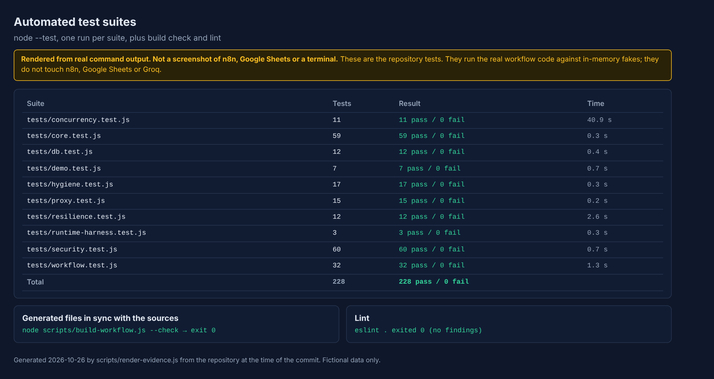
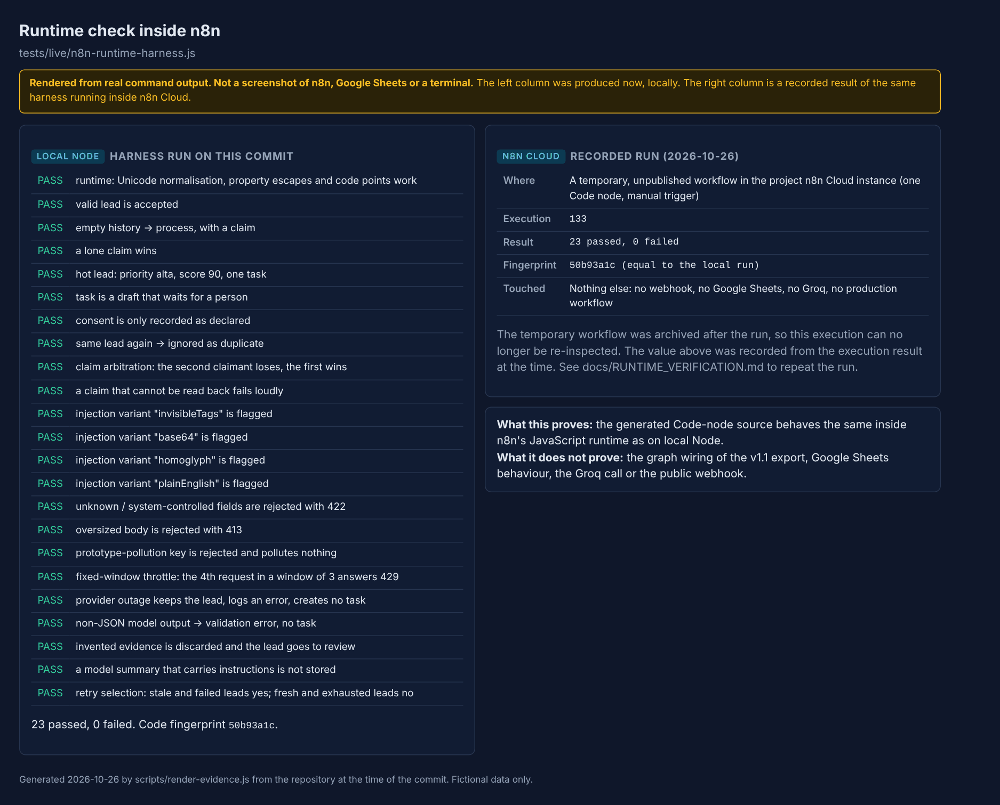

# Test report

Version 1.1.0, run on 2026-10-26 with Node 22.23.4 on Linux (`node --test`, no network, about 50 seconds, most of it the exhaustive concurrency suite). Result at the latest commit on this branch: **228 tests, 228 passed, 0 failed, 0 skipped**; ESLint reported no findings; `node scripts/build-workflow.js --check` confirmed that every generated file matches `src/`. On GitHub, the pull request run for commit `aed75e2` succeeded: tests on Node 20, 22 and 24, lint and dependency audit, and CodeQL (one run each; later commits get their own runs, shown on the pull request).



*Rendered from the real command output; not a terminal screenshot.*

## Vocabulary

| Label | Meaning |
| --- | --- |
| **Executed, passed** | The test was run in this session and passed. |
| **Executed, failed** | The test was run and failed. None remain; defects found on the way are listed below. |
| **Prepared, not run** | Written or documented but not executed, usually because it needs a service or a person. |
| **Blocked** | Cannot be done from the environment used (no network route, no browser, no credentials). |
| **Simulated** | Runs the real project code, but Google Sheets, the model, n8n or the clock are in-memory fakes. A simulated pass is **not** equivalent to a real run. Most tests below are both executed-passed and simulated; the column says which. |

## Suites

| Suite | Tests | Fidelity | What it covers |
| --- | --- | --- | --- |
| `tests/core.test.js` | 59 | Local code | Hashing, validation, normalisation, masking, duplicates and retries, AI request and answer validation, scoring thresholds and caps, drafts |
| `tests/workflow.test.js` | 32 | Simulated (vm sandbox) + structural | The generated export: unique node names, valid graph, one choke point before the model, claim path, retries, no send-mail node, no secrets, webhook auth configured, every Sheets write maps all columns; the real generated Code-node code run in order |
| `tests/security.test.js` | 60 | Simulated | Strict schema and type confusion, server-side trust, consent provenance, formula injection, 22 prompt-injection variants, privacy redaction, secret scrubbing, throttling, upgrade from v1.0 rows |
| `tests/concurrency.test.js` | 11 | Simulated (interleaving) | Claim arbitration under every interleaving of two executions, 500 random schedules of three, negative control, crashed winner, stuck-row recovery |
| `tests/resilience.test.js` | 12 | Simulated (fault injection) | Sheets failures at every stage, 15 model failure modes, bounded retries, partial failures, error handler, a 200-lead soak with random faults |
| `tests/proxy.test.js` | 15 | Mocks | The Worker: origins, size, whitelist, strict consent, honeypot, challenge, relay of upstream answers, no leakage |
| `tests/db.test.js` | 12 | SQLite stand-in | Unique constraint semantics, compare-and-set recovery, threads racing for the same submissions |
| `tests/demo.test.js` | 7 | Simulated | Demo leads behave as documented; `demo/expected-output.md` is up to date; Markdown cells cannot be broken out of with a backslash or a pipe |
| `tests/runtime-harness.test.js` | 3 | Local Node | The runtime harness passes and detects a mutated scoring table; safe to embed |
| `tests/hygiene.test.js` | 17 | Static | No credential-shaped strings, sheet ids or real URLs; fictional domains only; CI least privilege and pinned actions; no dependencies; documentation set complete; links resolve; diagram sources up to date |

## The mandatory test plan

| # | Area | Where | Status | Notes |
| --- | --- | --- | --- | --- |
| 1 | Valid and invalid inputs | `core`, `security`, `demo` | Executed, passed, simulated | The n8n webhook itself is not involved |
| 2 | Missing required fields | `core`, `security` | Executed, passed, simulated | |
| 3 | Wrong types and extreme values | `security` (type matrix, boundaries, oversize, hostile backtracking input) | Executed, passed, simulated | |
| 4 | No authentication and invalid token | Export configuration in `workflow`; proxy relay of an upstream 401/403 in `proxy` | **Partly.** Configuration checked; the live behaviour is **blocked** here | Authentication is performed by n8n before the workflow. No route from the test environment to the owner's n8n instance exists, and no hostile traffic is sent to production. Check it with `npm run demo:send` using a wrong token |
| 5 | Repeated requests | `core`, `workflow`, `concurrency`, `demo` | Executed, passed, simulated | The v1.0 real-service check is in the historical table below; not repeated for v1.1 |
| 6 | Simultaneous requests | `concurrency`, `db` | Executed, passed, **simulated** | Real Google Sheets under parallel load: **prepared, not run, blocked**. The SQLite threads test is real concurrency on a different database |
| 7 | Malformed AI responses | `core`, `resilience` (15 modes), `demo` | Executed, passed, simulated | Canned answers; a live model was not used for v1.1 |
| 8 | Prompt injection | `security` (22 variants, end to end), `demo`, harness | Executed, passed | The model is simulated, so what is proven is that the **system** does not trust the model; the harness variants ran inside n8n |
| 9 | Provider 429 and 500 | `resilience` | Executed, passed, simulated | Error strings injected; no real provider call |
| 10 | Timeouts | `resilience` (model timeout) and export settings (30 s node, 240 s execution) | Executed, passed, simulated | n8n's enforcement of the timeouts is not exercised |
| 11 | Failures saving to Sheets or the database | `resilience`, `db` | Executed, passed, simulated | No real Google error injected |
| 12 | Partial failure between lead and task | `resilience` | Executed, passed, simulated | |
| 13 | Recovery and retries | `resilience`, `core`, `concurrency`, harness | Executed, passed, simulated | A real retry of a failed row was verified for v1.0 (historical table) |
| 14 | Secrets leaking into logs | `security` (secrets), `hygiene` | Executed, passed | Pattern based; it cannot prove the absence of every secret |
| 15 | Personal data in free text | `security` (privacy) | Executed, passed, simulated | Covers e-mail, phone, links, own name, company; other third-party data is not detected |
| 16 | Regression of existing behaviour | `core`, `workflow`, `demo` | Executed, passed, simulated | The v1.0 expectations are kept and extended; the v1.0 live workflow was not re-run |

## Checks that ran inside n8n

[RUNTIME_VERIFICATION.md](RUNTIME_VERIFICATION.md): the runtime harness ran the real generated Code-node source in n8n Cloud in an unpublished temporary workflow (execution 133, 23 of 23 checks, same fingerprint as the local run). That execution record was archived afterwards and cannot be re-inspected; the result rests on what was recorded at the time. Nothing else in the instance was touched.



## Problems found while testing (all fixed; the last two were in the tests themselves)

| Where | Defect | Found by |
| --- | --- | --- |
| Proxy | An array such as `["true"]` was coerced into a consent declaration | Mock test written for the strict-consent rule |
| Workflow | The run mode was derived from request data | Review of the graph (LF-10), now covered by graph tests |
| Duplicate arbitration | A test schedule looked the lead up before the winner stored it, hiding the real race | Tightening of the interleaving test and its negative control |
| Hygiene checks | E-mail regex false positives on `a@c.c` and tool names | Running the check on the repository |

## Not verified on real services for v1.1

- The v1.1 workflow end to end on n8n Cloud with live Google Sheets and Groq.
- The published webhook: `202`, `422`, `429`, `503` and wrong-token `403` answers from outside.
- Atomic append and read-after-write on Google Sheets under parallel requests.
- The v1.1 prompt and redaction against the live model.
- The proxy on Cloudflare, and the SQL option on PostgreSQL.

## Verified on real services for v1.0 (historical, 2026-10-26, fictional data)

These checks were made on the first version and have **not** been repeated for v1.1.

| Check | Result |
| --- | --- |
| Workflow created in an n8n Cloud instance through the n8n API (25 nodes, 24 connections) | Done. Deployed Code nodes and parameters were compared with the committed export and matched. |
| Groq call with the production request (model `openai/gpt-oss-120b`, `reasoning_effort`, `max_completion_tokens`, strict `json_schema`) and a fictional lead | HTTP 200, valid JSON following the schema, about 1 s. |
| Real model answer through the validation and scoring code | It found a bug: the model quoted "Podéis" while the message said "Podeis", so the evidence check would have discarded a correct intent. Matching became accent-insensitive (regression test added). |
| Full path in the real n8n engine with webhook, Sheets nodes and the AI node pinned | Done twice. Hot lead: score 90, priority `alta`, task `llamar`, due in 4 h, draft pending approval. |
| Real end-to-end manual executions (real Google Sheets, real Groq, fictional leads) | Hot lead stored with a task; the same lead again ignored as duplicate; lead without e-mail rejected; injection lead flagged and sent to review; lead without consent scored but no task. |
| Published webhook called from outside with the header token (PowerShell, fictional lead) | First call created the lead and its task; two repeats answered `200` and created nothing. The `202` body, the `422` response and a wrong-token `403` were not checked from outside. |
| Retry trigger on a hand-made `error_ia` row | The row was re-analysed, became `tarea_creada` and got a task; the history kept the earlier `error_ia`. A product the model proposed that was not in the message was removed and flagged. |

## How to repeat

```bash
npm run verify                         # build check, lint, all suites
node --test tests/concurrency.test.js  # one suite
npm run demo:local                     # offline demo
npm run demo:send                      # live check of your own webhook (needs .env)
```
