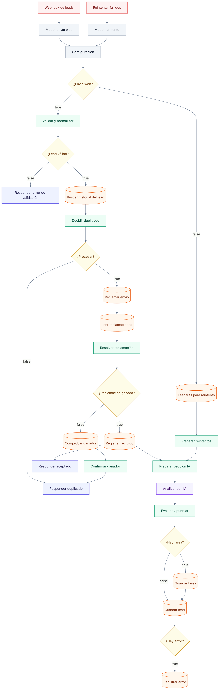
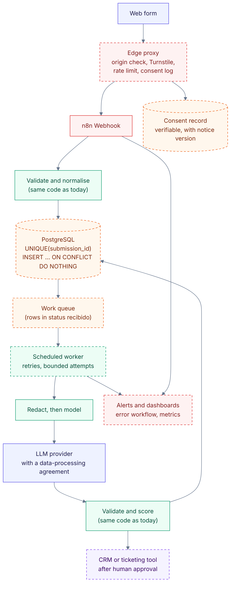

# Architecture

## Design goals

1. Safe with hostile input: lead text is untrusted data, never instructions.
2. Idempotent: the same lead sent twice never creates two records or two tasks (with the caveat in [CONCURRENCY.md](CONCURRENCY.md)).
3. Explainable: every score can be rebuilt from the stored breakdown.
4. Recoverable: a failure at any step leaves the lead in a state the workflow can pick up again.
5. Testable: all decisions live in plain JavaScript that tests import directly.
6. A human decides: no node sends a message.

## Current architecture (v1.1, implemented)

Editable source: [`diagrams/architecture-current.mmd`](diagrams/architecture-current.mmd). Colour code: red = access gate, green = Code node, orange = Google Sheets tab, blue = external service or HTTP answer, violet = a person.

The picture below is the **actual node graph of the export**, generated from `workflows/leadflow-sales-ai.json` by `scripts/workflow-to-mermaid.js`. It is not a screenshot of the n8n editor.

## Flow, step by step

1. **Webhook de leads** (POST, header token). The workflow answers early through *Respond to Webhook*, so the form never waits for the model.
2. A constant **Modo** node marks the run as `webhook`; *Reintentar fallidos* marks `retry`. Nothing the caller sends can choose the mode. **Configuración** holds the sheet id and the throttle settings.
3. **Validar y normalizar**: strict schema, size limits, text cleaning, masking of payment and ID numbers, prompt-injection analysis, disposable-domain and link checks, throttle, consent declaration and the derived ids:
   - `lead_id = "L-" + sha256(email)[:12]`
   - `submission_id = lead_id + "-" + sha256(email | normalised message | source)[:10]`
4. Invalid input is answered with 422 (413 if too large, 429 if throttled). Values are never echoed.
5. **Buscar historial del lead** reads the rows of the `lead_id`; **Decidir duplicado** returns `process`, `ignore` or `conflict` (see the table in [CONCURRENCY.md](CONCURRENCY.md)). A new message from the same e-mail is processed and flagged `contacto_repetido`; ten or more from the same contact are refused.
6. **Reclamar envío**, **Leer reclamaciones**, **Resolver reclamación**: insert-then-verify arbitration. A lost claim goes to **Comprobar ganador** and **Confirmar ganador** and answers 200 (duplicate) or 503 (in progress).
7. **Registrar recibido** stores the lead as `recibido` and the flow answers 202.
8. **Preparar petición IA** builds the request with a strict JSON schema from the **redacted** message only.
9. **Analizar con IA** (Groq, OpenAI-compatible): 30 s timeout, three attempts, errors do not stop the flow.
10. **Evaluar y puntuar** validates the answer and builds the rows:
    - invalid JSON, enum outside the schema, missing summary or a truncated reply give `error_validacion_ia`; API errors or empty replies give `error_ia`;
    - evidence quotes, the product and the figures in the summary must appear in the message;
    - form values override model values for budget and timeframe;
    - a flagged message discards the model's intent;
    - score and priority come from `computeScore`;
    - without a consent declaration the status is `sin_consentimiento` and no task is created.
11. **Guardar tarea**, then **Guardar lead**. The task is written first, so a failed task write leaves the lead as `recibido` and recoverable.
12. **Registrar error** logs a bounded, scrubbed message when a failure occurred.

Retry mode: *Reintentar fallidos* reads all rows, selects `error_ia`, `error_validacion_ia` and stale `recibido` rows with fewer than 3 attempts, and re-enters at step 8.

An **optional second workflow** (`workflows/leadflow-sales-ai-error-handler.json`) is set as the *Error workflow* of the first one and writes one bounded row to `errores` when an execution fails.

## Statuses

`recibido`, `tarea_creada`, `sin_consentimiento`, `error_ia`, `error_validacion_ia`, `error_definitivo`. Every transition is appended to `status_history` with a timestamp.

## Proposed architecture (NOT implemented)

Dashed boxes do not exist yet. They are where the known limits would be removed: an edge proxy with a bot challenge and a verifiable consent log, a relational store with a unique constraint and a work queue, a scheduled worker for retries, alerting, a provider with a data-processing agreement, and an integration with a CRM that runs only after a person approves. The proxy and the SQL option exist as reference code (`proxy/`, `db/`) but are not deployed or wired in. Source: [`diagrams/architecture-future.mmd`](diagrams/architecture-future.mmd).

## Why one JavaScript file

n8n Code nodes cannot import local modules. `scripts/build-workflow.js` copies only the regions each node needs (marked with `//#region name :: deps` comments) plus a small glue file from `src/nodes/` into the node's code, and generates the workflow exports, the CSV templates and the JSON Schema. The tests load the same `src/lead-core.js`, and a separate test runs the generated node code in a Node `vm` sandbox that mimics `$input` and `$()`. A test fails if a committed generated file is out of date. [RUNTIME_VERIFICATION.md](RUNTIME_VERIFICATION.md) shows how the same code is checked inside n8n.

## Safety design

- Lead text is data: it is wrapped in `<lead_message>` tags with angle brackets removed, redacted, and the system prompt tells the model to ignore instructions inside it. This is a mitigation, not a guarantee, which is why the priority never depends on the model alone.
- Cells are written with the `RAW` format and neutralised against formula injection.
- The exports contain no secrets; credentials are placeholders.
- No node sends e-mail or messages.

Details: [THREAT_MODEL.md](THREAT_MODEL.md), [SECURITY_REVIEW.md](SECURITY_REVIEW.md).
